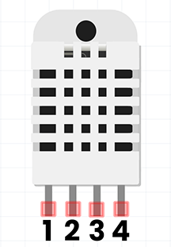
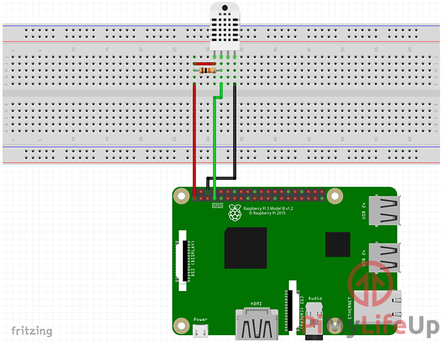

> using DHT22 AM2302 Digital Temperature and Humidity sensor via raspberry pi 4 and using nodejs to make a realtime app for displaying the measurements alongside with python3 to read data from the sensor

# Requirement
1. raspberry pi 
2. DHT22 Humidity sensor
3. nodejs installed
4. python3 installed with `Adafruit_DHT` library

# Get started

### for python
```
sudo apt-get update
sudo apt-get upgrade
sudo apt-get install python3-dev python3-pip
sudo python3 -m pip install --upgrade pip setuptools wheel
sudo pip3 install --install-option="--force-pi" Adafruit_DHT
```
`you have to run humidity.py file with python3 not 2`

### for nodejs
```
npm i 
npm run dev
```

#### Sensor

1. Pin 1 is VCC (Power Supply)
2. Pin 2 is DATA (The data signal)
3. Pin 3 is NULL (Do not connect)
4. Pin 4 is GND (Ground)

#### Diagram


1. Place a 10k resistor between Pin 1 and Pin 2 of the DHT22
2. Wire Pin 1 of the DHT22 to Physical Pin 1 (3v3) on the Pi
3. Wire Pin 2 of the DHT22 to Physical Pin 7 (GPIO4) on the Pi
4. Wire Pin 4 of the DHT22 to Physical Pin 6 (GND) on the Pi


#### Gpio pins

